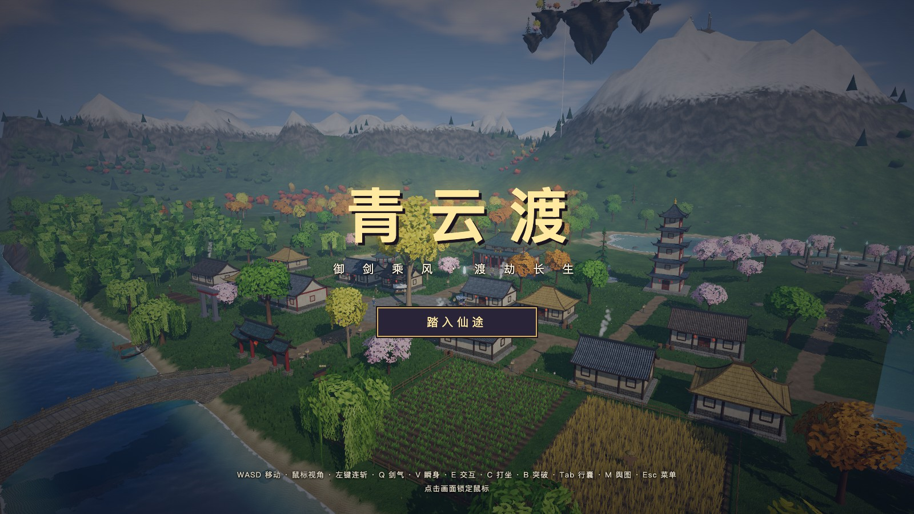
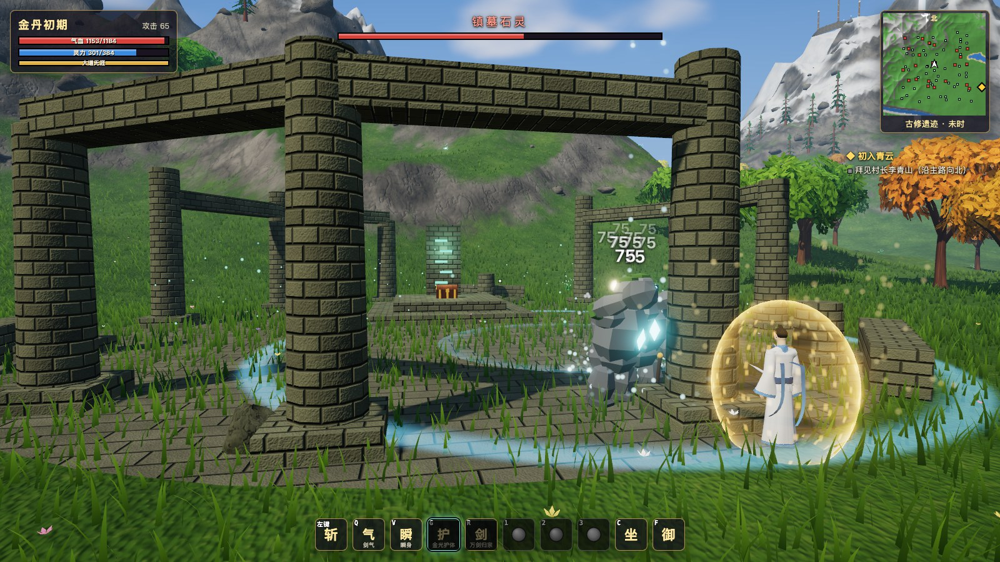
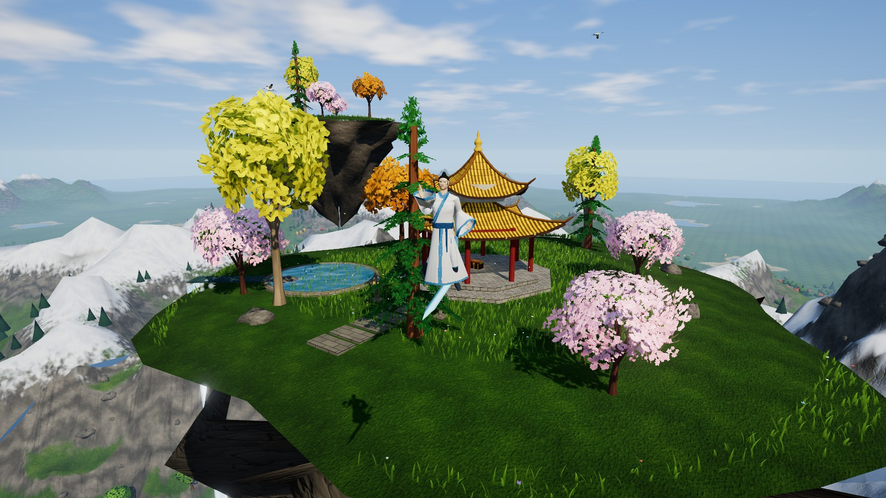
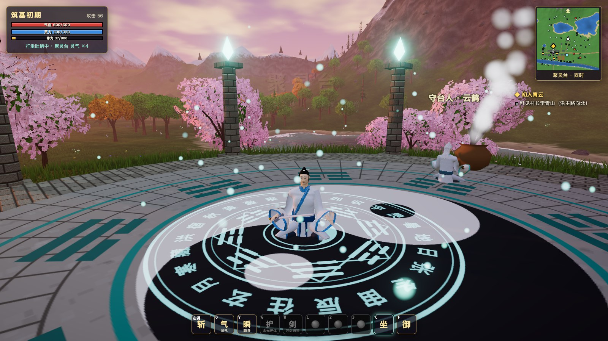
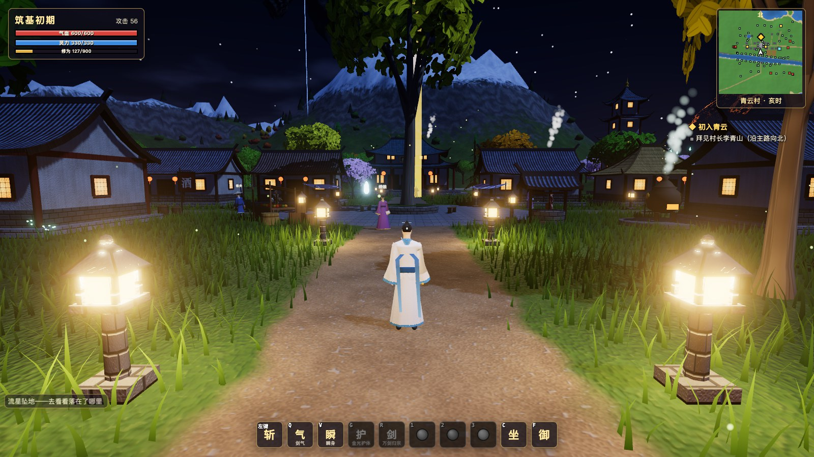
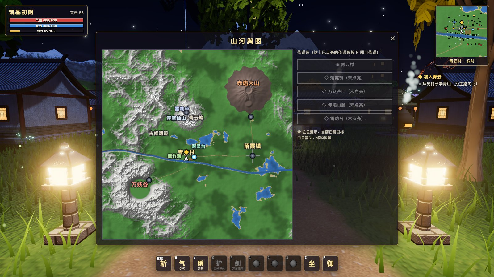

<div align="center">



<h1>青云渡</h1>

<p><code>QINGYUN&nbsp;&nbsp;CROSSING</code></p>

<p><strong>御剑乘风，渡劫长生。</strong><br>
由 <strong>Fable 5.2</strong> 与 <strong>Opus 5.5</strong> 参与生成，打开浏览器就能玩的 3D 开放世界修仙 Demo。</p>

<p>
  <a href="https://norwinyu.github.io/qingyun-du/"></a>
  
  
  
</p>

<p>
  <a href="#这是什么">这是什么</a> ·
  <a href="#玩法">玩法</a> ·
  <a href="#截图">截图</a> ·
  <a href="#操作">操作</a> ·
  <a href="#技术">技术</a> ·
  <a href="#制作方式">制作方式</a> ·
  <a href="#开始游玩">开始游玩</a>
</p>

</div>

---

## 这是什么

**《青云渡》是一个单人、第三人称、纯前端的 3D 开放世界修仙游戏。**

故事从青云村外的一座石桥开始。你是一个刚醒来的凡人，进村、拜见村长、测灵根、打坐引气，
然后一路走过古修遗迹、落霞镇、万妖谷、赤焰火山与浮空仙山，直到在雷劫台渡过九霄天雷。

「渡」是过桥，是渡河，也是渡劫。

<table>
<tr>
<td width="25%" align="center"><strong>类型</strong><br><sub>开放世界 · 动作修仙</sub></td>
<td width="25%" align="center"><strong>平台</strong><br><sub>浏览器 · 键鼠</sub></td>
<td width="25%" align="center"><strong>引擎</strong><br><sub>three.js · WebGL2</sub></td>
<td width="25%" align="center"><strong>体量</strong><br><sub>单文件 1.3 MB</sub></td>
</tr>
</table>

没有客户端，没有服务器，没有外部美术资源。地形、建筑、人物、贴图、音效全部在运行时生成，
整个游戏就是 `index.html` 加一个 `dist/game.js`。

---

## 玩法

### 世界是走出来的

青云村、落霞镇、翠竹海、古修遗迹、万妖谷、赤焰火山、浮空仙山、雷劫台——
八片区域连成一张无缝地图，昼夜与晴雨实时变化。徒步、疾行、二段跳、轻功滑翔、游泳，
筑基之后还可以御剑飞上云端。

<table>
<tr>
<td width="55%"></td>
<td width="45%" valign="middle">

**从石桥进村**<br>
<sub>河、桥、酒肆、灵田、码头、传送阵，一座能生活的小村庄。</sub>

**八片地貌**<br>
<sub>竹林、雪山、火山、妖谷、浮空岛，各有自己的物产与危险。</sub>

**天气会改变玩法**<br>
<sub>雨天灵田长得更快，金鳞龙鱼在雨夜更容易出现。</sub>

</td>
</tr>
</table>

### 战斗是打出来的

不是站桩丢技能。轻击可以连成**三段连斩**，右键**弹反**敌人出手，`V` **瞬身**躲过致命一击并触发子弹时间，
打出破绽后靠近可以**处决**。四门功法——剑气、瞬身、金光护体、万剑归宗——构成一套能打连招的动作体系。

敌人会带**狂暴、坚甲、迅捷、嗜血、爆裂、寒霜**六类精英词缀；首领有独立阶段、召唤与范围技。
野外、秘境、天劫里各有一套战斗节奏。

<table>
<tr>
<td width="45%" valign="middle">

**镇墓石灵**<br>
<sub>古修遗迹的守关首领，重击前摇明显，贪刀要付出代价。</sub>

**镜中剑魔**<br>
<sub>秘境第五层的最终对手，剑势比石灵更快。</sub>

**心魔**<br>
<sub>金丹雷劫之后出现——“斩不断的，从来都是自己。”</sub>

</td>
<td width="55%"></td>
</tr>
</table>

### 修行是坐出来的

测灵根是随机的：金、木、水、火、土，以及稀有的**雷灵根**；灵根品阶还会影响修为速度。
在聚灵台、古修遗迹、雷劫台、浮空仙山打坐，灵气倍率从 2 倍到 8 倍不等。
修为圆满后按 `B` 突破，炼气九层渡小天劫，筑基圆满渡九道天雷。

<table>
<tr>
<td width="55%"></td>
<td width="45%" valign="middle">

**御剑**<br>
<sub>筑基并完成云鹤的任务后按 F 起飞，穿越十四道灵环。</sub>

**渡劫**<br>
<sub>天雷会锁定落点，瞬身是唯一的解法；渡劫时不能御剑逃跑。</sub>

**金丹**<br>
<sub>当前版本的终点，也是下一段旅程的起点。</sub>

</td>
</tr>
</table>

### 也可以只是过日子

采药、炼丹、炼器、种六块灵田、在码头钓一整天鱼、接悬赏、护送行商、救一只九尾灵狐。
宗门声望分五级身份，贡献可以换永久被动功法。这些不是点缀——炼丹决定你能不能筑基，
灵田决定你多久能凑齐筑基丹的材料。

<table>
<tr>
<td width="33.3%"><br><sub><strong>聚灵台 · 酉时打坐</strong><br>灵气 ×4，桃花与晚霞</sub></td>
<td width="33.3%"><br><sub><strong>青云村 · 亥时</strong><br>灯笼亮起，流星偶尔坠地</sub></td>
<td width="33.3%"><br><sub><strong>入道 · 角色定制</strong><br>性别、发型、衣着、配色</sub></td>
</tr>
</table>

### 每次进去都不一样

- **秘境**：五层云端试炼，每层随机布局与敌人组合，清层后三选一增益，末层挑战镜中剑魔。
- **装备**：五档品质、三个部位、随机词条；精英必掉灵宝，首领掉得更好。
- **悬赏**：每游戏日刷新，击杀、采集、钓鱼、护送、精英，五种委托。
- **奇遇**：五处古修残魂、古修遗匣、仙山宝匣、夜间流星。

七章主线依次是：**青云初醒 → 遗迹石灵 → 落霞风云 → 万妖谷 → 铸就道基 → 炎阳遗恨 → 九霄雷劫**。
通关后仍可继续刷装备、刷灵环、刷秘境，或把村子里的日子过下去。

---

## 截图

<table>
<tr>
<td width="50%"><br><sub>青云村 · 石桥与青云河</sub></td>
<td width="50%"><br><sub>御剑 · 浮空仙山</sub></td>
</tr>
<tr>
<td width="50%"><br><sub>古修遗迹 · 镇墓石灵</sub></td>
<td width="50%"><br><sub>聚灵台 · 酉时打坐</sub></td>
</tr>
<tr>
<td width="50%"><br><sub>青云村 · 亥时灯会</sub></td>
<td width="50%"><br><sub>山河舆图 · 传送阵</sub></td>
</tr>
</table>

> 全部为游戏实际运行画面，`?q=1` 画质，1600×900。原图在 [docs/screenshots](docs/screenshots)。

---

## 操作

| | | | |
| --- | --- | --- | --- |
| `WASD` 移动 | `Shift` 疾行 | `空格` 跳跃 / 二段跳 / 滑翔 | 鼠标 视角 |
| 左键 三段连斩 / 处决 | 右键 格挡 / 弹反 | `Q` 剑气 | `V` 瞬身 |
| `G` 金光护体 | `R` 万剑归宗 | `E` 交互 / 采集 / 对话 | `C` 打坐 |
| `B` 突破 | `F` 御剑 | `1` `2` `3` 丹药 | `Tab` 行囊 |
| `M` 舆图 | `Esc` 菜单 | | |

完整按键、数值与任务路线：[**玩法指南**](docs/gameplay.md)。

---

## 技术

| | |
| --- | --- |
| **渲染** | three.js r187 / WebGL2，ACES 色调映射、泛光、调色与暗角，PCF 阴影，水面平面反射 |
| **世界** | 64 m 分块流式地形，远景低模 + 实例化植被，昼夜与天气插值，程序化建筑 |
| **人物** | 运行时用 SDF 图元拼装网格，Web Worker 构建，程序化骨骼动作与飘带布料 |
| **美术** | 所有贴图由 Canvas 2D 绘制；所有模型由代码生成；没有一张外部图片 |
| **音频** | WebAudio 振荡器与噪声合成；没有一个音频文件 |
| **构建** | esbuild 两段构建：人物 Worker → 文本内联 → 单文件 IIFE |
| **存档** | localStorage，自动保存 + 手动保存，无后端 |
| **质量** | `node:test` 30 项回归测试；`npm test` 在 CI 中运行 |

```
index.html + dist/game.js  =  整个游戏
```

没有 CDN，没有资源目录，部署只需要两个文件。这也是它能直接放在 GitHub Pages 上的原因。

---

## 制作方式

这是一个人机协作的产物，模型和分工写在这里：

<table>
<tr><td width="22%"><strong>生成模型</strong></td><td><strong>Fable 5.2</strong> 与 <strong>Opus 5.5</strong></td></tr>
<tr><td><strong>模型生成</strong></td><td>游戏代码、程序化场景与角色、界面、文案与文档初稿</td></tr>
<tr><td><strong>人的工作</strong></td><td>玩法方向、提示词、试玩、数值与手感调整、回归测试、部署</td></tr>
<tr><td><strong>验证</strong></td><td>30 项 <code>node:test</code> 全过；真实浏览器截图为证，不是渲染概念图</td></tr>
</table>

> 模型负责把想法写成能跑的 three.js 代码；人负责判断它好不好玩。
>
> 这个项目里没有预渲染的“概念图”——你看到的每一张截图，都是游戏跑起来之后的画面。

---

## 开始游玩

### 在线

**<https://norwinyu.github.io/qingyun-du/>**

推荐最新版 Chrome / Edge / Safari，需要 WebGL2 与键盘鼠标。

### 本地

```bash
git clone https://github.com/NorwinYu/qingyun-du.git
cd qingyun-du
npm install
npm run dev
```

打开 **<http://localhost:8000/>**。

也可以构建后用静态服务器：

```bash
npm run build
npm run preview      # http://127.0.0.1:8123/
```

> 首次加载约 1.3 MB，之后走浏览器缓存。存档保存在当前浏览器，`localhost` 与 Pages 的存档互不相通。

### 部署

仓库内置 GitHub Actions。推送到 `main` 后，在 **Settings → Pages → Source** 选择 **GitHub Actions** 即可。
详见 [部署说明](docs/deployment.md)。

---

## 文档

| | |
| --- | --- |
| [玩法指南](docs/gameplay.md) | 完整玩法、数值、任务路线与版本边界（含剧透） |
| [开发文档](docs/development.md) | 架构、模块职责、构建流程、调试接口、技术债 |
| [部署说明](docs/deployment.md) | GitHub Pages 两种部署方式与排错 |
| [更新日志](CHANGELOG.md) | 版本记录 |

## 已知限制

- 单人离线 Demo，无联机、无账号、无云存档。
- 修炼上限为**金丹初期**。
- 需要键鼠，未适配触屏与手柄。
- 代码以 Demo 为目标，`main.js` 仍偏大，尚未做模块级拆分。

## License

[MIT](LICENSE) © 2026 NorwinYu

<div align="center">
<sub>Made with <strong>Fable 5.2</strong> &amp; <strong>Opus 5.5</strong> · three.js · esbuild</sub>
</div>
