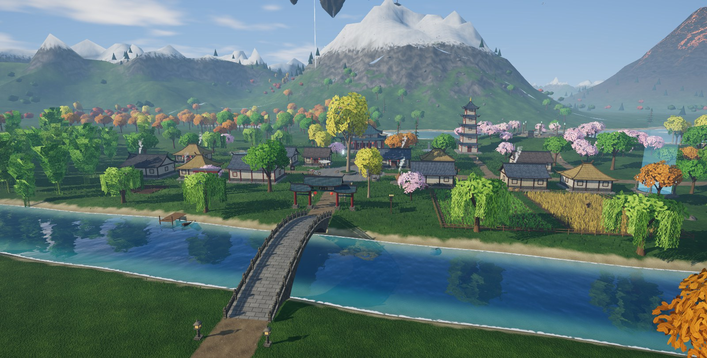
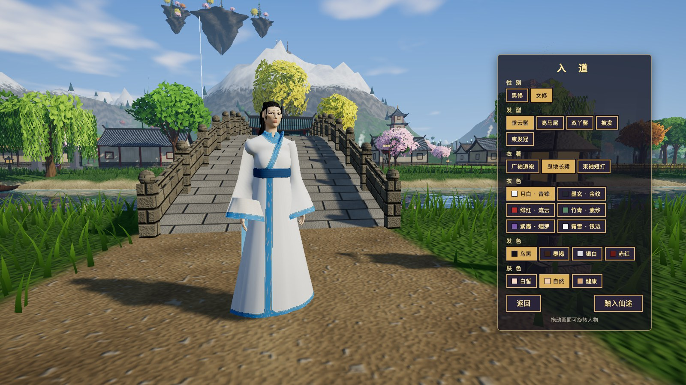

<div align="center">


# 青云渡

**御剑乘风 · 渡劫长生**

一个纯前端、零外部美术资源的 3D 开放世界修仙 Demo。
从凡人打坐到金丹渡劫，全部跑在浏览器里。

[](https://norwinyu.github.io/qingyun-du/)
[](https://threejs.org/)
[](https://www.khronos.org/webgl/)
[](LICENSE)
[](docs/deployment.md)

[玩法指南](docs/gameplay.md) · [开发文档](docs/development.md) · [部署说明](docs/deployment.md) · [更新日志](CHANGELOG.md)

</div>

---

## 为什么叫「青云渡」

故事从青云村外的一座石桥开始。**渡**，是过桥，是渡河，也是渡劫——
从凡人渡过炼气、筑基，最后在九霄雷劫中渡成金丹。

> 青云之上，一剑渡长生。

英文名 *Qingyun Crossing*，仓库名 `qingyun-du`。

## 这是什么

《青云渡》是一个可以直接在浏览器里玩的单人第三人称修仙 Demo，使用 three.js 从零搭建：

- **开放世界**：青云村、落霞镇、翠竹海、古修遗迹、万妖谷、赤焰火山、浮空仙山、雷劫台，可徒步、轻功、游泳、御剑。
- **完整成长线**：测灵根 → 打坐 → 突破 → 筑基小天劫 → 金丹九霄雷劫，当前上限为**金丹初期**。
- **动作战斗**：三段连斩、剑气、格挡弹反、完美闪避、处决，以及四门可参悟的功法。
- **修仙生活**：采药、炼丹、炼器、种灵田、河边垂钓、悬赏榜、护送行商、宗门宝库。
- **随机性**：五层秘境 + 三选一增益、五档装备品质与随机词条、六类精英词缀。
- **全部程序化**：地形、树木、建筑、人物、贴图、音效均由代码生成，没有任何外部模型或图片素材。

## 截图

| | |
|:--:|:--:|
| <br><sub>青云村 · 石桥与青云河</sub> | <br><sub>聚灵台 · 酉时打坐（灵气 ×4）</sub> |
| <br><sub>御剑 · 浮空仙山</sub> | <br><sub>青云村 · 亥时灯会</sub> |
| <br><sub>古修遗迹 · 镇墓石灵</sub> | <br><sub>入道 · 角色定制</sub> |

更多界面截图见 [docs/screenshots](docs/screenshots)，包括山河舆图等。

## 快速开始

### 在线游玩

打开 **<https://norwinyu.github.io/qingyun-du/>**（部署后生效，见[部署说明](docs/deployment.md)）。

### 本地运行

需要 Node.js 18+：

```bash
git clone https://github.com/NorwinYu/qingyun-du.git
cd qingyun-du
npm install
npm run dev
```

`npm run dev` 会监听源码并启动 esbuild 本地服务，打开 **<http://localhost:8000/>** 即可。

也可以先构建、再用任意静态服务器预览：

```bash
npm run build
npm run preview      # http://127.0.0.1:8123/
```

> 首次加载需要下载约 1.3 MB 的 `dist/game.js`，之后由浏览器缓存。
> 建议使用最新版 Chrome / Edge / Safari，并确保浏览器支持 WebGL2。

## 操作

| 操作 | 按键 |
| --- | --- |
| 移动 / 疾行 | `W A S D` / `Shift` |
| 视角 / 缩放 | 鼠标移动 / 滚轮（点击画面锁定鼠标） |
| 跳跃 / 二段跳 / 滑翔 | `空格`（炼气三层后二段跳，下落时按住滑翔） |
| 普通攻击 | 鼠标左键，连点衔接三段连斩；破绽时靠近可处决 |
| 格挡 / 弹反 | 按住鼠标右键；敌人出手瞬间按下可弹反 |
| 剑气 / 瞬身 / 护体 / 万剑归宗 | `Q` / `V` / `G` / `R` |
| 交互 / 采集 / 对话 / 传送 | `E` |
| 打坐 / 突破 | `C` / `B` |
| 御剑飞行 | `F`（筑基后）；飞行中 `空格` 升、`X` 降、`Shift` 加速 |
| 丹药 / 行囊 / 舆图 / 菜单 | `1` `2` `3` / `Tab` / `M` / `Esc` |

完整操作、玩法与数值说明见 **[玩法指南](docs/gameplay.md)**。

## 项目结构

```text
qingyun-du/
├── index.html              # 游戏入口（也是 GitHub Pages 的落地页）
├── favicon.svg
├── src/
│   ├── main.js             # 主循环、场景编排、输入、镜头、调试接口
│   ├── game.js             # 存档、境界、背包、任务、装备与数值
│   ├── data.js             # 境界、灵根、物品、任务、丹方、配方、对话
│   ├── player.js           # 玩家物理、战斗、镜头、捏人参数
│   ├── actors.js           # NPC、妖兽、首领、宠物与 AI
│   ├── side.js             # 悬赏、护送、灵田、垂钓、灵环、声望
│   ├── trial.js            # 秘境五层试炼
│   ├── ui.js               # HUD、地图、背包、对话、菜单
│   ├── world.js            # 分块地形、植被实例、碰撞
│   ├── height.js           # 高度场、群系、道路权重
│   ├── build.js / build2.js # 村庄、城镇、遗迹、火山的程序化建筑
│   ├── human/              # 程序化人物：SDF 拼装、绑定、动作、Worker
│   ├── fx.js / particles.js # 技能特效、预警圈、粒子
│   ├── sky.js / water.js   # 昼夜天空、云、水面反射
│   ├── postfx.js           # 泛光与调色后处理
│   ├── audio.js            # WebAudio 合成音效与环境声
│   └── loot.js             # 装备品质、随机词条、精英词缀
├── tests/                  # node:test 回归测试（30 项）
├── docs/                   # 玩法、开发、部署文档与截图
├── dist/game.js            # 构建产物（已提交，便于直接部署）
└── .github/workflows/      # GitHub Pages 自动部署
```

> 目录以实际文件为准；`build/` 与 `node_modules/` 不入库。

## 技术实现

| 方面 | 做法 |
| --- | --- |
| 渲染 | three.js r187，WebGL2，ACES 色调映射、泛光、调色与暗角 |
| 世界 | 以 64 m 为块流式生成地形；远景低模、树木/岩石实例化、GPU 草地 |
| 人物 | 运行时用 SDF 图元拼装网格，Worker 生成，程序化骨骼动作与布料飘带 |
| 贴图 | 全部由 Canvas 2D 程序化绘制，无外部图片 |
| 音频 | WebAudio 振荡器与噪声合成，无音频文件 |
| 打包 | esbuild，两段构建：人物 Worker → 文本内联 → 单文件 IIFE |
| 存档 | `localStorage`，自动保存 + 手动保存，无后端 |
| 测试 | `node:test` + esbuild 在 Node 里直接跑游戏逻辑（30 项） |

构建后只有一个 `dist/game.js`，天然适合静态托管。

## 开发与调试

```bash
npm run dev        # 监听构建 + 本地服务（:8000）
npm run build      # 生产构建
npm run build:dev  # 带 sourcemap 的构建
npm test           # 运行 30 项回归测试
```

URL 参数：

| 参数 | 作用 |
| --- | --- |
| `?q=0` / `?q=1` / `?q=2` | 流畅 / 均衡 / 极致画质 |
| `?auto=1` | 跳过标题直接新开一局 |
| `?auto=2` | 读取存档继续 |
| `?cam=x,y,z,tx,ty,tz&hour=17.5` | 自由镜头与时辰，用于截图 |

浏览器控制台里的 `window.G` 提供 `tp()`、`view()`、`cheat()`、`skip()`、`loot()`、`meteor()` 等调试方法，详见[开发文档](docs/development.md)。

## 文档

| 文档 | 内容 |
| --- | --- |
| [玩法指南](docs/gameplay.md) | 完整玩法、数值、任务路线与版本边界（含剧透） |
| [开发文档](docs/development.md) | 架构、模块职责、构建、调试接口、测试与技术债 |
| [部署说明](docs/deployment.md) | GitHub Pages 的两种部署方式与常见问题 |
| [更新日志](CHANGELOG.md) | 版本记录 |

## 已知限制

- 单人离线 Demo，无联机、无账号、无云存档。
- 修炼上限为**金丹初期**；金丹之后的内容尚未实现。
- 需要键盘 + 鼠标，暂不适配触屏。
- 存档跟随浏览器与访问地址；`localhost` 与 GitHub Pages 的存档互不相通。
- 代码以 Demo 为目标，`main.js` 较大，尚未做模块级拆分。

## 制作

- 设计与代码：在 **Fable 5.2** 与 **Opus 5.5** 辅助下完成，经人工试玩、调参与回归测试。
- 引擎：[three.js](https://threejs.org/)（MIT）。
- 构建：[esbuild](https://esbuild.github.io/)（MIT）。
- 场景、角色、贴图与音效均为程序化生成；若你发现与某作品相似，欢迎指出。

## License

[MIT](LICENSE) © 2026 binghong
