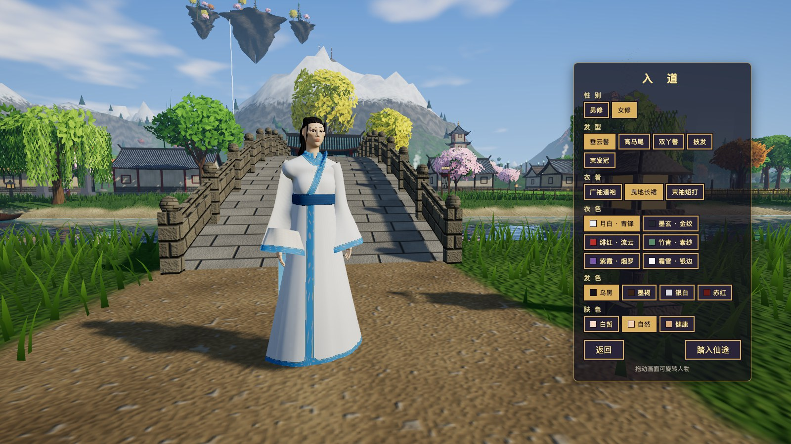
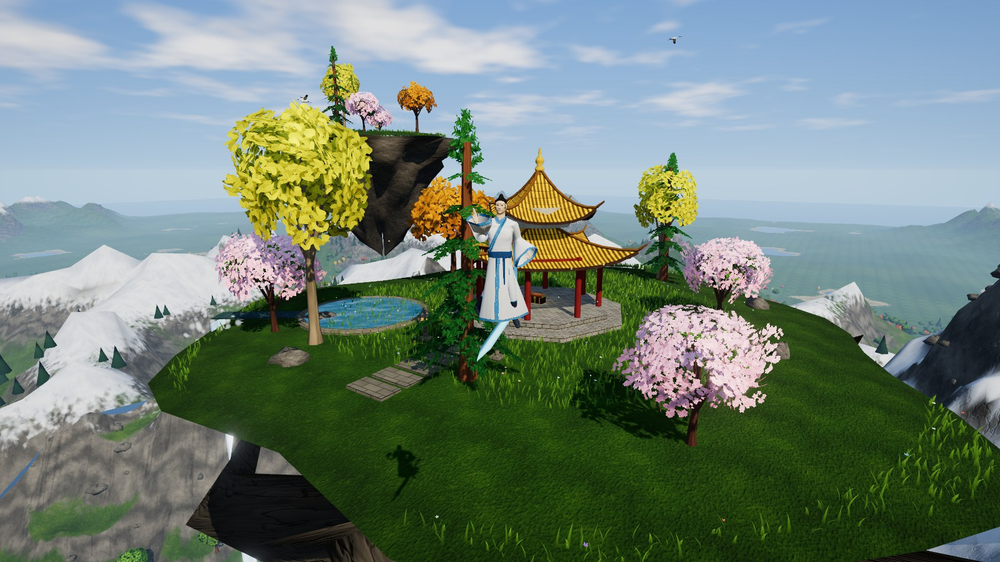
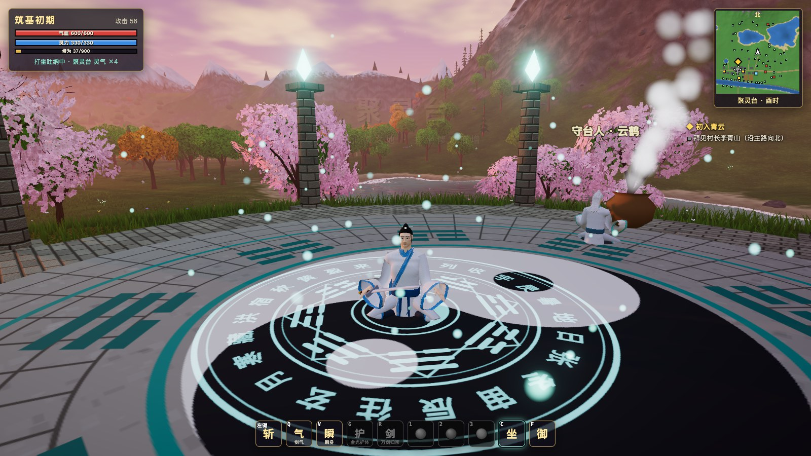
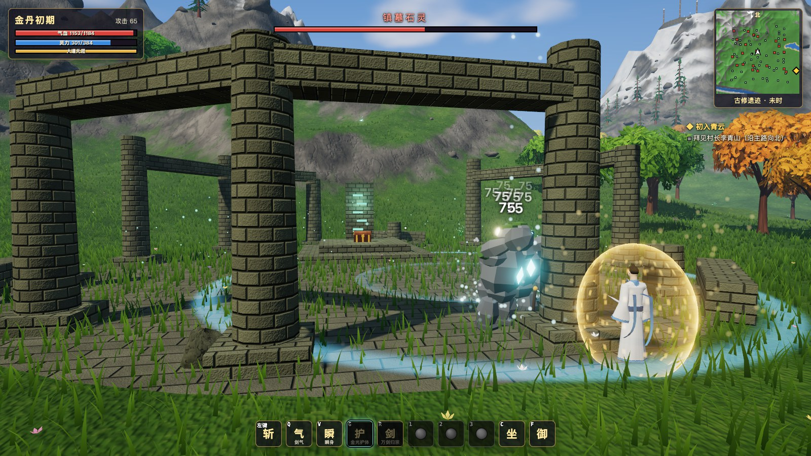

# 青云渡 · 玩法指南

> 适用版本：**v1.0.0** ｜ 单人第三人称 3D 开放世界修仙 ｜ 当前修炼上限：**金丹初期**
>
> 本文按当前源码整理，只介绍已经实现的内容，不代表后续计划。**包含剧情与奖励剧透**。

## 目录

- [一、玩法总览](#overview)
- [二、基础操作](#controls)
- [三、世界与探索](#world)
  - [3.1 开局角色定制](#creator)
  - [3.2 主要区域与天气](#regions)
  - [3.3 御剑飞行](#flight)
  - [3.4 灵环挑战](#rings)
  - [3.5 灵狐、奇遇与寻宝](#encounters)
- [四、修行与成长](#growth)
  - [4.1 剧情任务](#story)
  - [4.2 灵根](#roots)
  - [4.3 打坐、突破与渡劫](#realm)
  - [4.4 装备与灵宝](#gear)
  - [4.5 宗门声望与宝库](#reputation)
- [五、战斗与挑战](#combat)
  - [5.1 战斗方式](#fight)
  - [5.2 妖兽、精英与首领](#mobs)
  - [5.3 秘境试炼](#trial)
- [六、生活与江湖](#life)
  - [6.1 悬赏榜](#bounty)
  - [6.2 护送行商](#escort)
  - [6.3 灵田种植](#farm)
  - [6.4 码头垂钓](#fishing)
  - [6.5 炼丹](#alchemy)
  - [6.6 炼器](#forge)
  - [6.7 商店与灵石](#shop)
- [七、系统](#systems)
  - [7.1 地图与传送](#map)
  - [7.2 存档](#save)
  - [7.3 死亡、卡死与重开](#death)
- [八、推荐体验顺序](#route)
- [九、当前版本范围](#scope)

## 一、玩法总览

| 玩法 | 主要内容 | 参与方式 / 条件 |
| --- | --- | --- |
| 开局角色定制 | 男修、女修、发型、衣着与配色 | 新建游戏时选择 |
| 开放世界探索 | 村镇、山林、遗迹、火山、浮空仙山 | 徒步、轻功、游泳、御剑 |
| 剧情任务 | 从初入青云到九霄雷劫，另有采药、锻剑、灵兽等任务 | 与带任务标记的角色交谈 |
| 灵根与修炼 | 测灵根、打坐、积累修为、突破境界 | 测灵石交互，`C` 打坐，`B` 突破 |
| 实时战斗 | 三段连斩、剑气、格挡弹反、完美闪避、处决 | 鼠标与技能按键 |
| 妖兽与首领 | 普通妖兽、六类精英词缀、多种首领 | 野外探索、任务与秘境 |
| 装备收集 | 五种品质、三个部位、随机词条、分解 | 击败敌人、完成任务、宝库兑换 |
| 秘境试炼 | 五层随机战斗、三选一增益、末层首领 | 炼气境后进入村中秘境之门 |
| 悬赏榜 | 击杀、采集、钓鱼、护送、精英悬赏 | 村中告示牌接取 |
| 宗门声望 | 五级身份、贡献兑换、永久被动功法 | 完成悬赏、击败首领等 |
| 灵田种植 | 六块田、五种种植材料、生长与收获 | 村西南灵田交互 |
| 河边垂钓 | 抛竿、咬钩反应、收线小游戏、稀有鱼获 | 码头尽头按 `E` |
| 御剑灵环 | 十四道灵环、计时评级、最佳纪录 | 筑基并解锁御剑后，在灵环台开始 |
| 灵狐伙伴 | 跟随、协同攻击、御剑随行、危急疗伤 | 推进万妖谷与灵兽契约任务 |
| 奇遇与寻宝 | 古修残魂、宝匣、夜间流星与陨铁 | 探索世界并靠近交互 |
| 炼丹与炼器 | 五张丹方、四种锻造配方 | 分别通过药师任务、魔君任务解锁 |
| 商店与传送 | 灵石买卖、激活传送阵、快速旅行 | 与商人交谈、站上传送阵交互 |

**十分钟上手**：

1. 进村北大殿拜见村长，拿到铁剑与《引气诀》。
2. 用测灵石测灵根，去聚灵台按 `C` 打坐，踏入炼气境。
3. 帮药师采药、替猎户清狼，解锁炼丹并打造青锋剑。
4. 继续主线：古修遗迹 → 落霞镇 → 万妖谷 → 筑基渡劫。
5. 筑基后按 `F` 御剑，世界才真正打开。

## 二、基础操作

| 按键 | 功能 |
| --- | --- |
| `W A S D` | 移动 |
| `Shift` | 地面疾行；御剑时加速，消耗灵力 |
| 鼠标移动 | 调整视角，点击游戏画面可锁定鼠标 |
| 鼠标滚轮 | 调整镜头远近 |
| 方向键 | 辅助调整视角 |
| `空格` | 跳跃；炼气三层后可二段跳，下落时按住可滑翔 |
| 鼠标左键 | 普通攻击，连点衔接三段连斩；满足条件时处决 |
| 鼠标右键 | 持续格挡，在合适时机按下可弹反 |
| `Q` | 剑气，炼气一层解锁 |
| `V` | 瞬身，炼气二层解锁 |
| `G` | 金光护体，参悟《金刚护体诀》后可用 |
| `R` | 万剑归宗，参悟同名功法后可用 |
| `E` | 对话、接取或交付任务、采集、开宝匣、使用设施 |
| `C` | 打坐 / 停止打坐，须先习得引气诀 |
| `B` | 修为圆满后尝试突破 |
| `F` | 开启 / 关闭御剑，须筑基并解锁御剑 |
| 御剑时 `空格` / `X` | 上升 / 下降 |
| `1` / `2` / `3` | 服用回春丹 / 凝神丹 / 聚气丹 |
| `Tab` 或 `I` | 打开 / 关闭行囊 |
| `M` | 打开 / 关闭山河舆图 |
| `Esc` | 菜单，包含画质、音量、保存进度、回村等 |

钓鱼时，`空格` 或左键用于抛竿、提竿和收线；`WASD` 或 `E` 用于结束垂钓。秘境选择增益时，可点击卡片或按 `1`、`2`、`3`。

## 三、世界与探索

### 3.1 开局角色定制 

- 可选择男修或女修。
- 男修有束发冠、高马尾、披发、短发；女修有垂云髻、高马尾、双丫髻、披发、束发冠。
- 衣着可选广袖道袍、曳地长裙、束袖短打。
- 有六套服饰配色、四种发色、三种肤色。
- 创建时可拖动画面旋转人物；当前不是自由调整五官比例的捏脸系统。

人物使用程序化动作，包含移动、战斗、打坐、御剑、游泳、抛竿收竿、种植收获等，并有头发、衣摆和飘带动态表现。

### 3.2 主要区域与天气 

| 区域 | 可以做什么 |
| --- | --- |
| 青云村 | 接取初期任务、测灵根、交易、炼丹、接悬赏、种植、垂钓、进入秘境 |
| 聚灵台与桃花林 | 高效打坐，与云鹤道长推进修行任务 |
| 翠竹海与古修遗迹 | 寻找镇墓石灵、开启古修遗匣 |
| 落霞镇 | 交易、接取镇南妖患和灵兽契约等任务 |
| 万妖谷与妖王洞 | 对抗血狼和妖狼王，救出九尾灵狐 |
| 赤焰火山与封魔台 | 寻找炎姬、挑战熔岩魔君、解锁地火炼器 |
| 青云峰与雷劫台 | 高阶修炼、金丹渡劫 |
| 浮空仙山 | 御剑探索青云宗遗址、开启仙山宝匣、高效修炼 |

世界有昼夜、晴雨变化，高处有雪景，火山区有落灰和岩浆危险。天气也影响种植和部分鱼获的出现机会。

### 3.3 御剑飞行 

突破筑基并向云鹤完成相关任务，获得御剑能力后，按 `F` 起飞。可用视角和移动键调整方向，空格升高、`X` 降低、`Shift` 加速。

御剑可用于远行、到达浮空仙山、接近高山设施。加速消耗灵力，普通飞行不持续消耗灵力。秘境与天劫中不能开启御剑。

### 3.4 灵环挑战 

**入口**：村东北的灵环台，约坐标 `(27, -48)`，需筑基并解锁御剑。

- 按 `E` 开始，经过三秒倒计时后计时。
- 依次穿过十四道灵环，金色标出当前目标，后续灵环以蓝色显示。
- 全部通过后结算评级并保存最佳用时。
- 计时超过 240 秒、玩家死亡，或关闭御剑持续超过 2.5 秒时中断。

| 评级 | 完成用时 |
| --- | --- |
| 甲 | 少于 75 秒 |
| 乙 | 75 秒至不足 100 秒 |
| 丙 | 100 秒及以上，在挑战时限内完成 |

首次完成获得 **200 灵石、50 声望、50 贡献**。后续完成也有奖励，甲等或刷新纪录可获得额外收益。

### 3.5 灵狐、奇遇与寻宝 

**灵狐伙伴**：推进“万妖谷”任务，击败妖狼王并打开囚笼后，九尾灵狐“雪团”会跟随玩家，协助攻击附近追击玩家的敌人；御剑时会坐上剑尾。

之后找落霞镇灵兽阁主白芷，交付 3 颗妖丹完成“灵兽契约”，可解锁气血危急时的自动疗伤，有冷却时间。当前不是多灵宠捕捉、养成和切换系统。

**古修残魂与宝匣**：

- 世界中有五处古修残魂奇遇，靠近按 `E` 聆听往事，完成对话后获得修为和灵石；每处只能领取一次。
- 古修遗匣包含千年灵芝、御剑诀等物品；仙山宝匣包含九转金丹、冰魄丹等物品。
- 宝匣开启状态会保存，同一存档不能反复领取。

**夜间流星**：夜间探索时可能遇到流星落地。前往落点交互可拾取天外陨铁，用于炼器；这是随机事件，不保证每晚出现。

## 四、修行与成长

### 4.1 剧情任务 

主要章节依次为：**青云初醒 → 遗迹石灵 → 落霞风云 → 万妖谷 → 铸就道基 → 炎阳遗恨 → 九霄雷劫**。

典型推进路线：

1. 到村北大殿拜见村长李青山，获得铁剑和引气诀。
2. 使用测灵石测试灵根，到聚灵台打坐，踏入炼气境。
3. 帮药师采药、替猎户清剿妖狼，向铁匠交付材料打造青锋剑。
4. 按任务要求挑战古修遗迹，击败镇墓石灵并开匣。
5. 沿东边官道到落霞镇，拜见天机阁主玄机子。
6. 深入万妖谷，斩杀妖狼王，打开囚笼救出灵狐。
7. 炼制筑基丹、修炼至炼气九层圆满，渡过小天劫，再向云鹤交付任务解锁御剑。
8. 前往赤焰火山，帮助炎姬击败熔岩魔君，取得万剑归宗并解锁炼器。
9. 御剑探索浮空仙山，取得九转金丹。
10. 筑基后期圆满后，在雷劫台渡九道天雷并斩杀心魔，突破金丹。

任务有前置条件，部分也有境界要求。右侧任务追踪、角色头顶标记和地图目标可辅助寻路。普通剧情任务完成目标后，通常还需回到对应角色处按 `E` 交付；悬赏则自动结算。主线结束后仍可继续探索和参与其他玩法。

### 4.2 灵根 

完成初期指引后，在测灵石按 `E` 测试。灵根随机生成：

| 灵根 | 效果 |
| --- | --- |
| 金 | 攻击提高 15% |
| 木 | 气血回复提高 60% |
| 水 | 灵力上限提高 25% |
| 火 | 剑气伤害提高 30% |
| 土 | 防御增加 8，气血上限提高 10% |
| 雷，稀有变异 | 剑气伤害提高 20%，天劫伤害减半 |

灵根品阶另有修为获取倍率：天灵根 1.6 倍、地灵根 1.35 倍、玄灵根 1.15 倍、伪灵根 1 倍。

### 4.3 打坐、突破与渡劫 

- 境界路线为：凡人 → 炼气一至九层 → 筑基初、中、后期 → 金丹初期。
- 打坐、击败妖兽、完成任务、服用聚气丹等可获得修为。
- 按 `C` 打坐可积累修为并恢复气血、灵力；灵气地点会额外加快打坐修炼。
- 修为圆满后按 `B` 突破。筑基需要背包中有筑基丹，金丹需要九转金丹，突破时消耗；不是先在行囊中直接使用这两种丹药。
- 筑基小天劫有三道天雷；金丹大天劫须在雷劫台触发，有九道天雷及后续心魔战。
- 渡劫时不能御剑逃离，可用瞬身规避攻击。

| 打坐地点 | 地点修炼倍率 |
| --- | --- |
| 封妖碑 | 2 倍 |
| 古修遗迹、地火灵脉 | 3 倍 |
| 聚灵台 | 4 倍 |
| 雷劫台 | 6 倍 |
| 浮空仙山 | 8 倍 |

上述是地点对打坐修为的倍率；有高度要求的地点需真正到达台面或仙山上。

### 4.4 装备与灵宝 

装备分为**佩剑、法衣、法宝**三个部位。除了任务、商店和锻造得到的固定装备，还有随机生成的灵宝：

| 颜色 | 品质 | 随机词条数量 |
| --- | --- | --- |
| 白 | 凡品 | 0 |
| 绿 | 良品 | 1 |
| 蓝 | 上品 | 2 |
| 紫 | 极品 | 3 |
| 橙 | 仙品 | 4 |

词条包括攻击、气血、防御、灵力、会心、会心伤害、吸血、回灵、身法和剑气加成。

- 普通敌人有机会掉落灵宝，精英必掉，首领掉落更好。
- 获取更强的灵宝时，系统会按综合评分判断是否自动装备，也可在行囊中手动选择。
- 可分解灵宝换灵石。随机灵宝库存上限为 40 件，超出时会自动处理未装备灵宝。
- 提升品质、词条搭配与角色境界，是当前主要的配装成长方向。

### 4.5 宗门声望与宝库 

声望决定身份，贡献用于消费，两者不是同一种资源。身份目前用于称号与宝库商品解锁，不是完整的宗门经营系统。

| 身份 | 所需累计声望 |
| --- | --- |
| 外门弟子 | 0 |
| 内门弟子 | 120 |
| 核心弟子 | 350 |
| 真传弟子 | 800 |
| 客卿长老 | 1600 |

在告示牌切换到“宗门宝库”可兑换：

| 商品 | 身份要求 | 贡献 |
| --- | --- | --- |
| 灵芝孢子 ×1 | 外门弟子 | 25 |
| 回春丹 ×2 | 外门弟子 | 20 |
| 聚气丹 ×2 | 内门弟子 | 45 |
| 《踏云步》，身法永久提高 8% | 内门弟子 | 90 |
| 冰魄丹 ×1 | 核心弟子 | 70 |
| 《归元心经》，气血 +80、灵力回复 +50% | 核心弟子 | 160 |
| 随机紫色极品灵宝 | 真传弟子 | 220 |
| 《太虚剑意》，攻击 +10%、会心 +5% | 真传弟子 | 280 |
| 随机橙色仙品灵宝 | 客卿长老 | 520 |

宝库的三本永久功法兑换后自动参悟，每本只能获得一次对应效果。声望和贡献还可通过击败首领、完成灵环挑战等途径获得。

## 五、战斗与挑战

### 5.1 战斗方式 

- **三段连斩**：连续点击左键衔接攻击，第三段为更重的终结斩。炼气后终结斩还可带出剑气。
- **格挡与弹反**：按住右键减轻可格挡攻击的伤害；敌人攻击命中前的短窗口内按下右键可弹反。部分范围攻击不能靠普通格挡处理。
- **完美闪避**：用 `V` 瞬身躲过命中，可触发短暂子弹时间，敌人动作减慢。
- **处决**：敌人被打出破绽、头顶出现提示后，靠近并朝向目标按左键，可发动高伤害处决。
- **技能搭配**：剑气远程消耗，瞬身规避，金光护体减伤，万剑归宗覆盖范围。
- **恢复与配装**：使用丹药、装备吸血或回灵等词条，提高续战能力。

《金刚护体诀》与《万剑归宗》等任务功法，获得后需在行囊中参悟；宗门宝库兑换的三本永久被动功法则自动参悟。

### 5.2 妖兽、精英与首领 

普通敌人包括妖狼、山猪、幽磷灵火、血狼、火灵等；主要首领包括镇墓石灵、妖狼王、熔岩魔君、秘境的镜中剑魔，以及渡劫中的心魔。

精英妖兽更强，并可能携带以下词缀：

| 词缀 | 主要特点 |
| --- | --- |
| 狂暴 | 攻击更高，出手更频繁 |
| 坚甲 | 减轻受到的伤害 |
| 迅捷 | 移动速度更快 |
| 嗜血 | 命中玩家后恢复自身气血 |
| 爆裂 | 死亡后产生危险爆炸 |
| 寒霜 | 命中后使玩家减速 |

### 5.3 秘境试炼 

**入口**：青云村西南的秘境之门，约坐标 `(-28, 26)`；需达到炼气一层。

1. 进入后挑战五层云端试炼。
2. 场地障碍布局、敌人组合和精英情况带有随机性，敌人强度随角色境界和层数变化。
3. 第一、二层各有两波敌人，第三、四层各有三波。
4. 前四层清场后，从三个随机增益中选择一个。
5. 踏入中央光阵前往下一层。
6. 第五层挑战镜中剑魔及随从，胜利后再踏入中央光阵返回村庄。

可选增益有：攻击、减伤、会心、会心伤害、吸血、身法、剑气、回灵、清层回血、处决强化和更长子弹时间，共十一种。**这些增益仅本次秘境生效**，不是永久功法。

奖励与规则：

- 每层清场获得灵石，记录最深抵达层数。
- 通关额外获得两件灵宝，其中一件保底紫色极品，另一件保底蓝色上品；另有聚气丹 2 枚、妖丹 3 枚。
- 首次通关额外获得 300 灵石；击败秘境首领也会增加声望与贡献。
- 秘境禁止御剑，可从菜单“回村”退出。
- 退出或失败后，已获得的灵石保留；秘境临时增益清除。读档不会从秘境中途继续闯层。

## 六、生活与江湖

### 6.1 悬赏榜 

**入口**：村中心主路东侧告示牌，约坐标 `(13, 33)`。

- 榜上最多三条悬赏，随境界生成适合当前阶段的目标。
- 类型包含指定妖兽击杀、野外采集、码头鱼获采办；炼气后还可能出现护送行商或精英击杀。
- **先接取，再完成目标**。库存里原有的材料、商店购买和灵田收获，不会直接计入野外采集悬赏。
- 每到游戏内新的一天自动更新，正在进行的悬赏保留；也可花 30 灵石刷新，护送途中不能手动刷新。
- 完成后自动发放灵石、声望与贡献，不必回榜交付。

### 6.2 护送行商 

接取后到村东口与周掌柜会合，靠近即可启程，沿官道护送至约 180 米外的目标处。

- 途中有两次妖兽伏击，清除伏击敌人后行商继续前进。
- 行商有独立气血；敌人在附近停留会使其受伤。
- 玩家走得太远时行商会等待，长时间远离、行商气血耗尽或玩家死亡会导致失败。
- 失败后可重新接取。读档后未完成的护送需要重新接取，不从途中续接。

### 6.3 灵田种植 

**入口**：秘境门以西的六块灵田，中心约坐标 `(-47, 24)`。

靠近空田按 `E`，选择持有的材料播种，每次消耗一份；成熟后再按 `E` 收获。不是所有材料都有单独的种子物品，前四项直接消耗对应灵材。

| 播种材料 | 晴天成熟所需有效游玩时间 | 收获 |
| --- | --- | --- |
| 灵草 | 100 秒 | 灵草 3～4 份 |
| 凝露花 | 140 秒 | 凝露花 2～3 份 |
| 赤炎果 | 180 秒 | 赤炎果 2～3 份 |
| 寒冰莲 | 240 秒 | 寒冰莲 2 份 |
| 灵芝孢子 | 480 秒 | 千年灵芝 1 份，另有机会返还孢子 |

- 达到雨天判定后，生长速度为平时的 1.6 倍。
- 千年灵芝是筑基丹的主药，灵芝孢子可从宗门宝库兑换。
- 作物生长进度会保存；只在游戏正常进行时生长，打开暂停面板或离线不会继续计时。
- 当前不需要浇水、施肥，也没有作物枯萎机制。

### 6.4 码头垂钓 

**入口**：青云村西南河边的木码头尽头，约坐标 `(-27, 41.5)`。

操作流程：

1. 落地后按 `E` 开始，角色自动持竿。
2. 按空格或左键抛竿，等待浮漂下沉和“咬钩”提示。
3. 及时按空格或左键提竿，过早提竿或反应过慢会让鱼逃走。
4. 进入收线阶段后，指针落在绿色区间时按键，提高收线进度。
5. 进度满则成功，误按、拖延或超时可能失败；稀有鱼更难收线。
6. 按 `WASD` 或 `E` 收竿离开。

| 鱼获 / 物品 | 用途 |
| --- | --- |
| 青鳞鲤 | 食用恢复 30% 气血，也可出售 |
| 银鳞鱼 | 出售换灵石 |
| 灵纹锦鲤 | 食用增加修为，夜间更容易出现 |
| 河蚌灵珠 | 出售换灵石 |
| 金鳞龙鱼 | 食用永久增加 20 点气血上限；雨天、夜间更容易出现 |

钓获金鳞龙鱼还会获得声望和贡献。系统保存各类鱼获的捕获次数，但当前没有独立的鱼获图鉴浏览界面。

### 6.5 炼丹 

完成药师苏婉的“悬壶济世”任务后，在丹炉按 `E` 使用。

凝露花可在村南石桥两侧的河岸、村西北凉亭旁的池塘边采集，外观是浅蓝白色发光花朵，靠近按 `E`。

| 丹药 | 材料 | 产出 / 效果 |
| --- | --- | --- |
| 回春丹 | 灵草 2、凝露花 1 | 2 枚；每枚通常恢复 60% 气血 |
| 凝神丹 | 凝露花 2、赤炎果 1 | 2 枚；恢复全部灵力 |
| 聚气丹 | 灵草 3、妖丹 1 | 1 枚；增加修为 |
| 冰魄丹 | 寒冰莲 1、妖丹 1 | 1 枚；永久增加 20 点气血上限 |
| 筑基丹 | 千年灵芝 1、妖丹 3、赤炎果 2 | 1 枚；筑基突破所需 |

九转金丹通过仙山宝匣获得，不在当前可炼制丹方中。修为已满时应先突破，再服用增加修为的物品。

### 6.6 炼器 

击败熔岩魔君并向炎姬交付任务后，在地火熔炉使用。

| 成品 | 材料 |
| --- | --- |
| 赤霄剑 | 地火之精 1、天外陨铁 1、妖丹 4 |
| 玄龟甲 | 野猪皮 6、妖丹 3、地火之精 1 |
| 赤炎葫芦 | 赤炎果 4、地火之精 1、灵石 60 |
| 灵犀玉佩 | 凝露花 4、天外陨铁 1、灵石 40 |

### 6.7 商店与灵石 

- 青云村药师出售基础丹药；落霞镇万宝楼出售丹药、部分装备、天外陨铁等。
- 灵石用于商店交易、部分任务与配方、悬赏手动刷新。
- 商人对话中的“出售妖兽材料”是批量出售入口，也会出售允许收购的鱼获与灵珠。
- 出售时保留 6 颗妖丹；“青锋出鞘”未完成时，还会保留 4 颗妖狼牙。
- 金鳞龙鱼也在可出售列表中，若打算食用增加气血，建议先使用再批量出售。

## 七、系统

### 7.1 地图与传送 

- 小地图显示周边角色、妖兽、灵草和传送阵等标记；任务目标可显示为金色菱形或光柱。
- 按 `M` 查看地图；快速传送须站在已点亮的传送阵上按 `E`，再选择另一个已点亮目的地，不能在任意位置直接通过地图传送。
- 传送目的地包括青云村、落霞镇、万妖谷口、赤焰山麓和雷劫台。

### 7.2 存档 

- 存档保存在当前浏览器的本地存储中，没有云端账号或跨设备同步。同一浏览器下更换访问协议、主机名或端口，也可能读不到原地址的存档。
- 菜单可手动保存。安全落地、脱离战斗且未渡劫时会周期性自动保存，部分关键操作也会保存。
- 存档包含角色外观、境界、物品装备、任务、灵根、声望贡献、灵田进度、鱼获次数和灵环最佳纪录等。

> **注意**：从 `localhost` 换到 GitHub Pages 后，旧的本地存档不会跟随过去；这是浏览器的同源策略，不是游戏 bug。

### 7.3 死亡、卡死与重开 

- 死亡后回青云村，恢复气血与灵力，但损失当前已积累修为的约 10%，不是倒退一个境界；护送等活动也会中断。
- 卡住时可用菜单“回村（脱离卡死）”。“重新开始”会清除当前游戏存档，操作前请确认。

## 八、推荐体验顺序

1. **先熟悉操作**：创建角色 → 拜见村长 → 测灵根 → 学会打坐与突破。
2. **准备基础战力**：完成采药与妖狼任务，解锁炼丹，打造青锋剑。
3. **穿插支线**：接悬赏、种灵材、钓鱼；炼气后尝试秘境，练习弹反和闪避。
4. **推进剧情**：探索遗迹 → 落霞镇 → 万妖谷 → 筑基，救出灵狐并解锁御剑。
5. **体验高阶内容**：挑战灵环、火山魔君、地火炼器、浮空仙山与金丹渡劫。
6. **持续游玩**：刷灵宝词条、尝试不同秘境增益组合、提升宗门身份、兑换永久功法、收集稀有鱼获、刷新灵环纪录。

## 九、当前版本范围

目前已具备探索、剧情成长、动作战斗、随机配装、秘境与生活玩法。以下内容不属于当前已实现功能：

- 多人联机、玩家交易、竞技场对战。
- 自由建造洞府、房屋或完整宗门经营。
- 完整职业树、技能加点、装备强化洗练。
- 自由五官捏脸、装备驱动的完整换装外观系统。
- 多灵宠捕捉与繁育、独立鱼获图鉴界面。
- 离线修炼、离线种植收益、云端存档。
- 金丹初期之后的修炼境界。

---

### 附：文档核对依据

- `src/data.js`：境界、灵根、任务、物品、丹方、炼器配方与商店。
- `src/main.js`、`src/player.js`、`src/actors.js`：操作、战斗、探索事件、灵狐、死亡与保存流程。
- `src/loot.js`：装备品质、词条与精英词缀。
- `src/trial.js`：秘境层数、增益与奖励。
- `src/side.js`：悬赏、声望宝库、护送、种植、垂钓与灵环。
- `src/ui.js`：界面入口、地图传送与操作提示。
